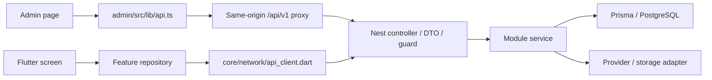

# Architecture and coding guide

## Repository map

| Directory | Stack / responsibility | Start tracing here |
|---|---|---|
| `admin` | Next.js 16.3.4, React 19, TypeScript, Tailwind 4 | `src/app`, `src/lib/nav.ts`, `src/lib/api.ts` |
| `backend` | NestJS 11 modular monolith, Prisma 6, PostgreSQL | `src/main.ts`, `src/app.module.ts`, `prisma/schema.prisma` |
| `customer-app` | Flutter/Dart customer application | `lib/main.dart`, `lib/features`, `lib/core` |
| `lawyer-app` | Flutter/Dart lawyer application | `lib/main.dart`, `lib/features`, `lib/core` |
| `website` | Next.js public marketing site | `src/app`, `src/content`, `src/components` |
| `docs/api` | Generated API collection/contracts | `backend/scripts/generate-api-docs.cjs` |

The backend is one deployable application composed of modules, not independently deployed microservices. Prisma defines persistent relationships and migrations; Redis/a durable queue should not be assumed to exist just because scheduling exists. Scheduled work currently runs within the API process.

## Request paths

Admin `next.config.ts` forwards `/api/v1/*` to `src/lib/api-origin.ts`. Development default in source is port 4000; the repository-local runner explicitly overrides this to port 4400. Production defaults to `https://api.amlst.in`. The alerts stream is a separate server route at `src/app/api/v1/admin/alerts/stream/route.ts` so SSE is not treated like buffered JSON.

Flutter repositories own endpoint mapping and response parsing. Both `core/network/api_config.dart` files default to the live API unless `API_BASE_URL` is passed at build/run time. The URL excludes `/api/v1`; repository request paths include it. Rebuilding is needed to change a compiled Dart define.

## Backend conventions

`main.ts` installs `/api/v1`, cookie parsing, credentialed CORS, strict DTO validation and a uniform error filter. Unknown request fields are rejected. Preserve the raw webhook body for HMAC verification. Global throttling applies; some auth/support actions have tighter limits.

Keep HTTP parsing/response headers in controllers; DTO validation in `dto/`; business rules, ownership and transactions in services; provider calls behind infrastructure adapters. Use Prisma transactions/conditional updates for money, matching and state transitions. Do not trust client payment callbacks, participant IDs, amounts, timestamps or role claims as authorization.

Admin access: `modules/admin-auth/admin-auth.guard.ts`, `route-permissions.ts` and `modules/admin-users/permission-catalogue.ts`. Cookie or Bearer access tokens are accepted, but database session validation and role permissions still apply. Super Admin is protected; users inherit role permissions rather than independent overrides. Role changes can invalidate sessions/access. Keep lookup endpoints permission-scoped.

Mobile auth: customer/lawyer guards enforce the correct token type and account state. Refresh-token storage is platform secure storage. Reuse the existing shared refresh behavior; do not add an independent fetch/HTTP stack per screen.

## Feature ownership and invariants

| Feature | Admin owner | Backend owner | Mobile owner |
|---|---|---|---|
| Lawyer onboarding | `components/lawyers`, `/lawyers/*` | `modules/lawyer-registration`, `admin-lawyers` | lawyer `features/registration` |
| Profile/bank edits | `components/lawyers/edit-*` | `lawyer-profile`, `admin-edit-requests` | lawyer `features/profile` |
| Customers | `components/customers` | `admin-customers`, `customer-auth` | customer auth/profile flows |
| Consultation | `components/consultations`, `lib/consultations.ts` | `consultations`, `admin-consultations` | customer `features/consultation`, lawyer `features/consultations` |
| Payments/billing | `components/billing`, `lib/billing.ts` | `payments`, `admin-billing`, `admin-settings` | customer `payment_service.dart` |
| Reports | Consultation record views | `reports`, `report-ai.service.ts` | both `features/reports` |
| Support | `components/support`, `lib/support.ts` | `modules/support` | both `features/support` |
| Notifications | `components/notifications` | `notifications`, `admin-alerts`, push infrastructure | `core/push`, feature notification repositories |

Important implementation rules:

- A signed-in lawyer is initially a draft. Only submitted/reviewed statuses appear in All Registered Lawyers; drafts are intentionally separate.
- Bank updates require a change request; other current profile edits save directly. Broader approval is a product policy decision, not an assumed implemented feature.
- Checkout provider is now Razorpay. `PaymentGateway` stores encrypted sandbox/production settings. `appId` in its DTO is the Razorpay Key ID; do not rename the wire contract casually. Historical Cashfree records remain provider-labelled; the old Cashfree controller is not mounted.
- Captured amount/order/currency must be verified server-side. Refund request/processing/completed are different states; never display a request as money returned. An ambiguous provider POST is not permission to issue another refund.
- Booking snapshots preserve pricing/duration/extension rules. Token issuance does not start paid time; both actual participants must join. Paid extensions need capture; free extensions remain idempotent. Rejoin must not reset the clock.
- Reports require lawyer delivery, ownership, complete customer profile and payment gating. Manual authoring remains available if AI fails. Do not auto-publish generated legal text.
- Support tickets/replies/attachments are persisted and owner/role scoped. Category permission is not ticket permission. Attachments are private; storage keys are not public URLs.
- Some admin screens are explicit previews. Reusing a generic table/modal does not turn preview actions into backend functionality.

## Models and migrations

Use `backend/prisma/schema.prisma` for exact field/relation names. Major groups: User/Profile/Documents/Session/OTP; admin roles/users/sessions/recovery; consultation request/session/offer/messages/extensions; payments/refund lifecycle/earnings; reports/attachments/recording; support tickets/messages/attachments/events; settings/audits.

Create additive migrations, inspect SQL and test against a backed-up local database first. Use `prisma migrate deploy` for applying committed migrations. Do not use reset/db-push against valuable or production data to bypass migration history. Keep the matching schema, Prisma client, backend and clients together when contracts change.

## Changing a feature

Trace screen → repository/client → controller → DTO/guard → service → model. Reuse the existing UI and network primitives. Implement authorization and error handling before wiring an action. Add a meaningful regression check for the actual failure, not a test that repeats the implementation. Record whether verification used local fixtures, mocked providers, sandbox providers or real devices. Update docs and regenerate API artifacts.

Business-critical tests are in `backend/tests`; Flutter tests in each app's `test`. The local HTTP fixture runner is `.local/verify-http.mjs` and exercises actual local auth/onboarding/proxy behavior. It is local setup tooling, not part of the production service.
